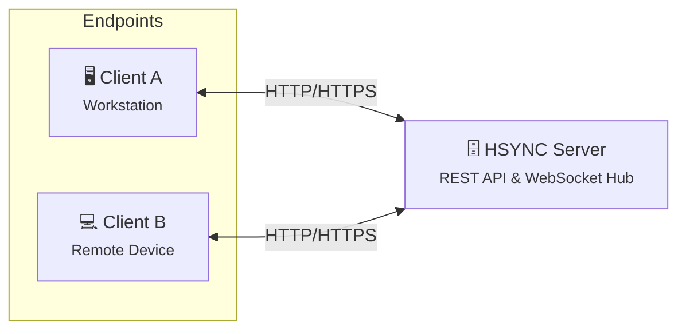
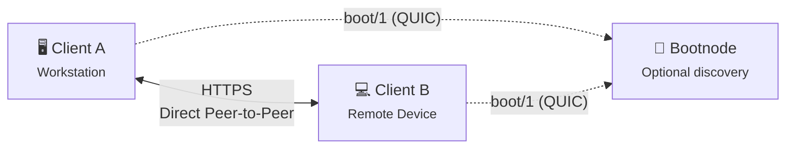
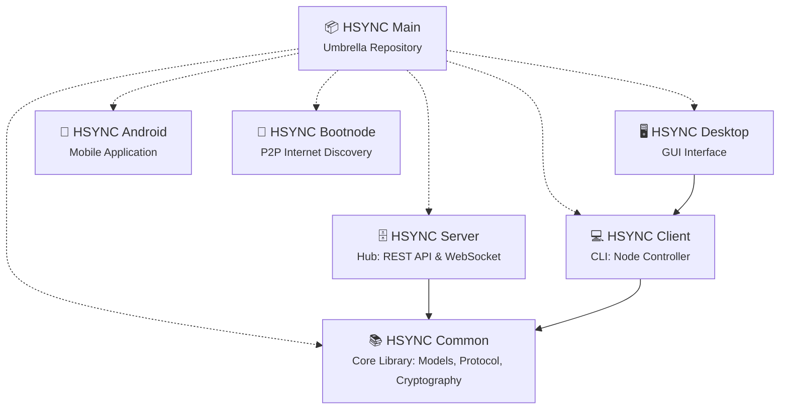

  

# HSYNC

**HSYNC** (HTTP Synchronization) is a secure, fast, **real-time file synchronization system** that keeps a folder identical on two or more computers using ordinary HTTPS protocol.

Install the client on the machines that matter: laptop, desktop, home server, NAS, cloud VM; point them at the same folder, and every change (a new document, an edited photo, a renamed directory, a deletion) appears on the other machines within seconds. There is no account to create with a third-party provider and no external service in the data path: HSYNC runs on hardware you own, and your files stay in their original format, directly browsable on disk.

It works for simple setups, two laptops sharing one folder at home and for demanding ones: a central server connecting several offices, isolated groups on the same network, or unattended syncs driven by scripts and schedulers. Same software, same protocol: from a single command to a fleet.

Everything HSYNC does - synchronization, transfers, events - travels over standard HTTP/HTTPS (REST and WebSocket), so it passes through the firewalls, proxies, and deep packet inspection systems of networks where custom protocols, SSH, or VPNs are not an option. The only instance in which peer discovery between devices on different networks takes place is when a different method is used (over QUIC), and only in the case where the devices are not on the same local area network.

> 👉 **Operational Advisory:** As with any automated filesystem mutation utility, administrators are strongly advised to maintain validated, independent backups prior to initial deployment in production environments.

---

## What you can do with HSYNC

* **Keep folders in sync** — hold the same folder on your laptop, desktop, and server; edit on any device and the others converge in seconds.
* **Back up a folder** — push it one-way to your own server or NAS, optionally without propagating deletions, so the destination never loses data just because a source file was removed.
* **Share and exchange files** — a synced folder works as a shared drop box: drop a file in on one machine (or let a colleague do it) and it lands on the others.
* **Publish a read-only copy** — distribute a mirror that other devices only download from and never write back to.
* **Sync without a server** — a few devices on the same network discover each other automatically and transfer directly, peer-to-peer, with no infrastructure to run.
* **Connect devices on different networks** — if a group is spread across networks and you do not want a central server, an optional self-hosted discovery node ([HSYNC Bootnode](https://github.com/albertsdk/hsync-bootnode)) lets the devices find each other; the file data keeps flowing directly between them.
* **Automate** — run one-shot syncs from cron, systemd timers, or CI pipelines with a documented exit code for scripting, or keep a long-running daemon that reacts to changes in real time.
* **Scale it up** — start with one folder, then add buckets, isolated groups with shared keys, ignore patterns, bandwidth limits, and per-device sync directions as your setup grows.

## Two ways to sync

HSYNC runs in one of two modes. Pick the one that fits each sync group.

### Server Mode — with a central server

A central [HSYNC Server](https://github.com/albertsdk/hsync-server) stores the shared folders (called **buckets**) and coordinates every device: changes travel to the server as standard REST API calls, and a persistent WebSocket connection announces them to the other devices, which then pull them immediately. Devices do not need to be online at the same time, they can live on different networks, and the server always holds a complete copy of the synchronized data.

**Choose it when:** you sync across networks or over the Internet, you want a central copy on hardware you own, you manage many devices or users, or you need a hub that is always reachable.

### p2p Mode — no server

Designed for serverless environments. Devices on the same local network autonomously discover one another over mDNS and perform direct synchronization over HTTP, peer-to-peer: the file data never passes through another machine, and there is nothing to install or administer beyond the devices themselves. If the group is spread across networks, the devices can use an optional self-hosted [HSYNC Bootnode](https://github.com/albertsdk/hsync-bootnode) (`boot/1` over QUIC/UDP 443) to discover each other — a stateless, no-log service that never sees your files. Only discovery leaves the local network: the synchronization data plane stays direct peer-to-peer over HTTPS/WSS.

**Choose it when:** a handful of devices share one network, you want the highest local throughput, or you prefer to run no server at all.

| Situation | Mode |
| --- | --- |
| Devices on different networks, or over the Internet | Server Mode |
| A central copy on hardware you own | Server Mode |
| Many devices, accounts, and access control | Server Mode |
| A few devices on the same network | p2p Mode |
| Direct transfers with no central copy | p2p Mode |
| No infrastructure at all — or a small self-hosted discovery node | p2p Mode (+ Bootnode across networks) |

## Choose your interface

[HSYNC Client](https://github.com/albertsdk/hsync-client) is the sync engine; several interfaces drive it, and they all speak the same protocols and share the same data model, so different clients can take part in the same sync group.

| Interface | What it gives you | Runs on | Status |
| --- | --- | --- | --- |
| **HSYNC Client** | The engine from the command line: every option, fully scriptable, headless. | Linux, macOS, Windows; `.deb` packages; WD My Cloud OS5 | ✅ Stable |
| **HSYNC Desktop** | A graphical app: start and stop sync, watch transfers, adjust settings, desktop notifications. | Windows, macOS, Linux | 🚧 In development |
| **HSYNC Android** | A phone/tablet app: pick a device folder and keep it in sync. | Android (SDK 33+) | 🚧 In development |

## Privacy, security & openness

* 🏠 **Private** — no vendor account and no third-party service in the data path: Server Mode stores your data only on the hub you run yourself, and p2p Mode transfers directly between your devices.
* 🪪 **Authenticated** — every installation has a stable **device ID** with its own ECDSA P-256 keypair; peers are trusted on first use and pinned by certificate fingerprint, so a changed identity is refused and only trusted devices are accepted.
* 🧾 **Encrypted** — TLS on every transport (REST/WebSocket in Server Mode, HTTPS/WSS in p2p Mode), with no plaintext payload path.
* 📖 **Open** — the wire protocol and file model are an open, versioned specification with shared schemas and fixtures (see the [protocol](https://github.com/albertsdk/hsync-common/blob/main/docs/protocol.md) and [p2p protocol](https://github.com/albertsdk/hsync-common/blob/main/docs/p2p-protocol.md) references), and development happens in the open.
* 📡 **No telemetry** — HSYNC sends no usage data or analytics anywhere.

## Getting started

1. **Install the client** — prebuilt binaries, `.deb` packages, the WD My Cloud OS5 installer, or source: [HSYNC Client → Installation](https://github.com/albertsdk/hsync-client/blob/main/docs/installation.md).
2. **Run your first sync** — follow the walkthrough for your mode: [Server Mode](https://github.com/albertsdk/hsync-client/blob/main/docs/getting-started-server.md) or [p2p Mode](https://github.com/albertsdk/hsync-client/blob/main/docs/getting-started-p2p.md).
3. **Running your own hub?** — install the server with Docker or natively: [HSYNC Server → Getting Started](https://github.com/albertsdk/hsync-server/blob/main/docs/getting-started.md).
4. **Looking for a concrete scenario?** — backup, mirror, multi-device, NAS, photos, scheduling: [HSYNC Client → Examples](https://github.com/albertsdk/hsync-client/blob/main/docs/examples.md).

## Architectural Applicability

HSYNC is engineered to operate seamlessly within:

* **Corporate Networks:** Operates over standard HTTP ports — the server listens on **9753** by default and is exposed on 443 by a reverse proxy (or directly with `--port 443`) — so it passes through existing firewalls, proxies, and deep packet inspection systems.
* **Cloud Infrastructures:** Fully compatible with standard IT infrastructure, including load balancers, Web Application Firewalls (WAFs), and reverse proxies.
* **Restricted Environments:** Functions autonomously in secure environments where standard administrative protocols (like SSH) or VPN access are prohibited.
* **Real-Time Workflows:** Replaces legacy polling mechanisms with event-driven, WebSocket-based push notifications for immediate data consistency.

## Technical Capabilities & Core Differentiators

### ⚙️ Core Performance Differentiators

* **Zero-Delay Sync (Fast after save):** Data transfer triggers immediately upon file closure, eliminating traditional quiet-window latencies and ensuring continuous pipeline synchronization.
* **Block-Level Delta Transfer:** For large files, the system transmits exclusively the modified data blocks (rsync-style). This drastically reduces bandwidth consumption and transfer times.
* **Direct P2P Mode:** Enables direct device-to-device synchronization without centralized server dependency, minimizing infrastructure load and maximizing local network throughput.

### 🛰️ Network & Architecture

* **Universal HTTP/HTTPS Compatibility:** Operates over standard HTTP/HTTPS ports, so it traverses common enterprise network setups without custom routing or additional port forwarding.
* **Deterministic Deletion Handling (Tombstones):** Employs strict tombstone tracking to prevent the accidental resurrection of deleted files across distributed nodes.
* **Native Symlink Support:** Accurately preserves symbolic links across platforms, a critical requirement for development environments and system administration.
* **Real-Time Architecture:** Event-driven architecture powered by WebSockets, eliminating the high overhead and inefficiency of traditional HTTP polling.
* **Private P2P Networks:** P2P clusters can be isolated from one another with a group filter and authenticated with a shared group key, so independent teams can share one physical network without ever mixing data.
* **Self-Hosted, No Vendor Lock-In:** every topology runs on infrastructure you own — the hub is your own server and buckets are plain directories on your filesystem, with no third-party service in the data path.

### 🛡️ Resilience & Data Integrity

* **Fault-Tolerant Transfers (Resumable uploads):** Automatically resumes interrupted transfers from the exact point of failure, ensuring reliable delivery of massive payloads over unstable connections.
* **Zstandard (Zstd) Compression:** Utilizes modern compression algorithms to optimize throughput, particularly effective on low-bandwidth links.
* **SHA-256 Integrity Verification:** Hashes every file end-to-end, so transmission corruption is detected before a file is committed.

### 🔐 Security, Governance & Deployment

* **Isolated Data Architecture (Bucket-based):** Organizes logical groups of files into isolated sync buckets, facilitating multi-tenant architectures and strict access control.
* **Standardized Authentication:** Secures endpoints via API Key (Bearer token) authentication, easily integrable with enterprise secret management systems.
* **Built-in Observability (Prometheus):** Exposes native metrics for direct integration into corporate monitoring and alerting stacks.
* **Containerized Deployment (Docker):** Ensures rapid, reproducible deployments via single `compose.yaml` files, ideal for cloud-native and on-premise scaling.
* **Infrastructure Protection (Rate Limiting):** Incorporates defense mechanisms against traffic spikes and abuse, ensuring high availability and service uptime.

## Market Comparison

The following table benchmarks HSYNC against industry standards across critical architectural dimensions.

| Tool | Protocol | HTTP-Native | Real-Time Sync | Native Storage | Architecture |
|------|----------|:---:|:---:|:---:|------|
| **HSYNC** | HTTP / HTTPS | ✅ | ✅ | ✅ | Hub-Spoke & P2P |
| rsync | SSH / Daemon | ❌ | ❌ | ✅ | Client-Server |
| Syncthing | BEP (Custom) | ❌ | ✅ | ✅ | P2P |
| Nextcloud | WebDAV (HTTP) | ✅ | ⚠️ ¹ | ✅ | Client-Server |
| Seafile | HTTP / HTTPS | ✅ | ⚠️ ¹ | ❌ ² | Client-Server |
| scp / sftp | SSH | ❌ | ❌ | ✅ | Client-Server |
| Unison | SSH / Socket | ❌ | ❌ | ✅ | P2P |
| Rclone | S3, SFTP, etc. | ⚠️ ⁴ | ❌ | ⚠️ ³ | Client-Server |

> **¹** Relies on local filesystem monitoring via a desktop client; lacks native event-driven push notifications (WebSocket) at the protocol level. 
> **²** Utilizes a proprietary block-based internal storage format, rendering files inaccessible from the filesystem without the server software. 
> **³** When utilizing the `crypt` backend, files are stored in an opaque encrypted format. 
> **⁴** Rclone's HTTP backend is restricted to read-only operations. Core synchronization requires non-HTTP protocols.

## Project Ecosystem

HSYNC is developed as a modular ecosystem of specialized repositories:

| Component | Function | Lifecycle Status |
| --- | --- | --- |
| **[HSYNC Client](https://github.com/albertsdk/hsync-client)** | CLI client: Server Mode and P2P Mode | ✅ Stable |
| **[HSYNC Server](https://github.com/albertsdk/hsync-server)** | Central sync hub: REST API, WebSocket relay, file storage | ✅ Stable |
| **[HSYNC Common](https://github.com/albertsdk/hsync-common)** | Shared library: data models, protocol, delta transfer, hashing | ✅ Stable |
| **[HSYNC Bootnode](https://github.com/albertsdk/hsync-bootnode)** | Optional Internet discovery node for P2P topologies: `boot/1` over QUIC, no-log, RAM-only | ✅ Stable |
| HSYNC Desktop | Desktop GUI front-end | 🚧 In development |
| HSYNC Android | Android client app | 🚧 In development |

*Note: All Stable components ship a full test suite and documentation, and are suitable for enterprise deployment.*

## Contributing

HSYNC is developed in the open. Bug reports, feature requests and pull requests are welcome — start with [CONTRIBUTING.md](CONTRIBUTING.md) and the [Code of Conduct](CODE_OF_CONDUCT.md).

## Security & Vulnerability Management

Report vulnerabilities through GitHub's private channel, never in a public issue:
**[Report a vulnerability](https://github.com/albertsdk/hsync/security/advisories/new)** — supported versions, patch management and hardening guidance are in the [Security Policy](SECURITY.md).

## A note from the maintainer

HSYNC is a passion project started by Alberto Basso. It is built in spare time,
with love. Please remember this when you interact with the project: everyone
involved is doing our best to build something great together, but it is not a
paid, full-time job for any of us.

## Licensing

The HSYNC ecosystem is released under the **[Mozilla Public License 2.0 (MPL 2.0)](LICENSE)**.

## Disclaimer

> [!WARNING]
> **HSYNC manipulates files and directories** — it creates, overwrites, moves, and deletes data.
> Misconfiguration, software defects, or other unforeseen conditions may lead to **data loss or
> corruption**. **Use at your own risk and always keep verified, independent backups.**

**Legal Disclaimer:** THE SOFTWARE IS PROVIDED "AS IS", WITHOUT WARRANTY OF ANY KIND, EXPRESS OR IMPLIED, INCLUDING BUT NOT LIMITED TO THE WARRANTIES OF MERCHANTABILITY, FITNESS FOR A PARTICULAR PURPOSE, AND NONINFRINGEMENT. IN NO EVENT SHALL THE AUTHORS OR COPYRIGHT HOLDERS BE LIABLE FOR ANY CLAIM, DAMAGES, OR OTHER LIABILITY, WHETHER IN AN ACTION OF CONTRACT, TORT, OR OTHERWISE, ARISING FROM, OUT OF, OR IN CONNECTION WITH THE SOFTWARE OR THE USE OR OTHER DEALINGS IN THE SOFTWARE.

This disclaimer supplements, and does not replace, Sections 6 ("Disclaimer of Warranty") and 7 ("Limitation of Liability") of the [Mozilla Public License 2.0](LICENSE), which govern this software.
