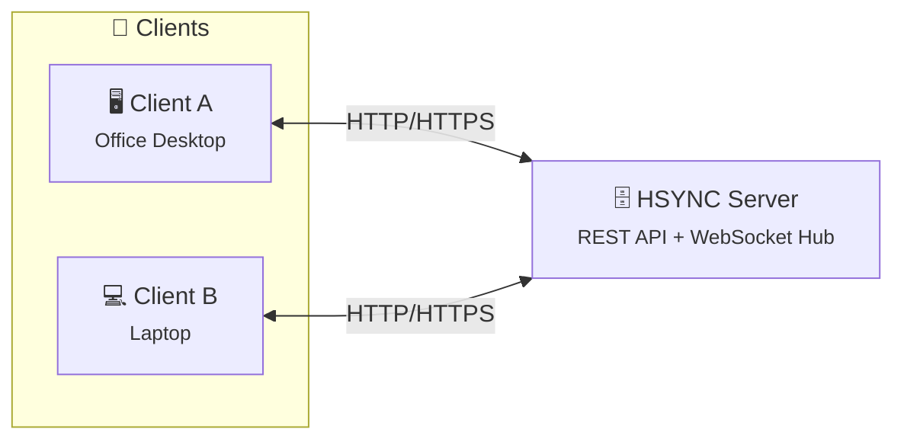
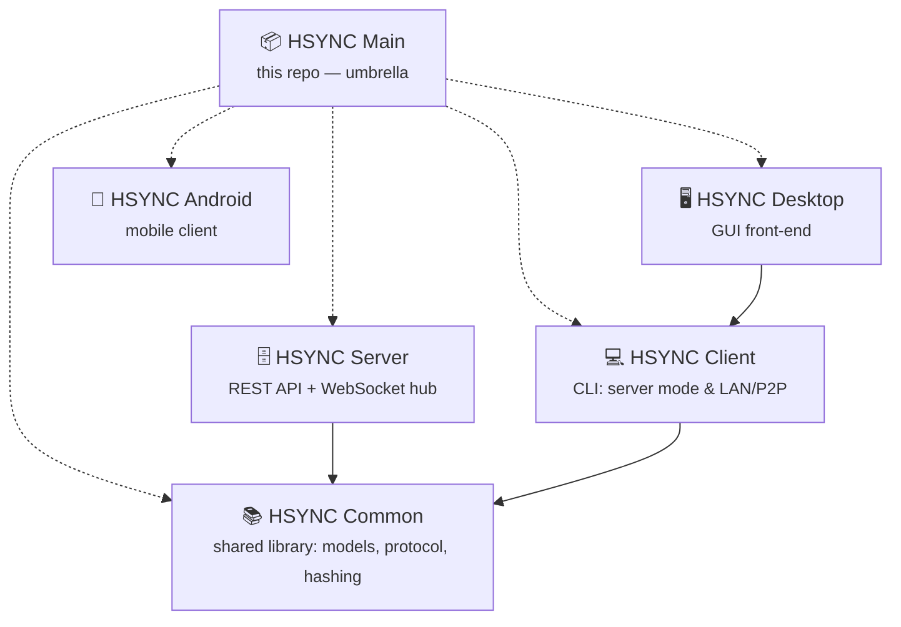

  

# HSYNC

**HSYNC** (HTTP Synchronization) keep your files in sync across all your devices 
**in real-time** using **only the HTTP/HTTPS protocol**.
This makes it the ideal choice in environments where HTTP is the only protocol
allowed through firewalls, proxies, or network policies — a common constraint in
corporate networks, cloud environments, and restricted infrastructures, no custom 
protocols, no SSH, no VPN required. The tool stores your **files As-Is** in their 
original format, directly browsable on disk — no proprietary containers, block 
stores, or opaque internal formats. 
Synchronization can occur via a central server or via P2P in a local network.

**HSYNC fits naturally into:**
- 🏢 **Corporate networks** — only ports 80/443 are open through the firewall
- ☁️ **Cloud environments** — services behind load balancers or reverse proxies
- 🔒 **Restricted infrastructures** — SSH is disabled, VPNs unavailable
- 🌐 **Web-friendly setups** — route traffic through CDNs, WAFs, or API gateways
- ⚡ **Real-time reactivity** — WebSocket-powered instant notifications, no polling

## Key Features

- 🚀 **HTTP/HTTPS only** — works through any proxy, firewall, or load balancer
- 📁 **Bucket-based organization** — group files into isolated sync folders
- 🔄 **Real-time sync** — WebSocket push notifications, no polling
- ⚡ **Fast after save** — once the editor closes the file, transfer starts in a fraction of a second (no fixed 5–10s quiet window); already-idle files skip the wait
- ⚡ **LAN/P2P Mode** — direct device-to-device sync without a server
- 🧩 **Delta transfer** — rsync-style block-level sync for large files
- ⏩ **Resumable uploads** — pick up interrupted transfers where they left off
- 🗜️ **Zstandard compression** — faster transfers over slow links
- 🔐 **API Key authentication** — simple, secure Bearer token auth
- ✅ **SHA-256 integrity** — every file is verified end-to-end
- 🪦 **Deletion tombstones** — prevent deleted files from being resurrected
- 🔗 **Symlink support** — preserve symbolic links across devices
- 🛡️ **Rate limiting** — protect the server from abuse
- 📊 **Prometheus metrics** — built-in observability
- 🐳 **Docker-ready** — deploy with a single `compose.yaml`

 

The table below compares HSYNC with common alternatives on five dimensions. 

| Tool | Protocol | HTTP | Real-Time | Files As-Is | Architecture |
|------|----------|:---:|:---:|:---:|------|
| **HSYNC** | HTTP / HTTPS | ✅ | ✅ | ✅ | Client-Server + P2P |
| rsync | SSH or rsync daemon | ❌ | ❌ | ✅ | Client-Server |
| Syncthing | BEP (custom) | ❌ | ✅ | ✅ | P2P |
| Nextcloud | HTTP / HTTPS (WebDAV) | ✅ | ⚠️ ¹ | ✅ | Client-Server |
| Seafile | HTTP / HTTPS | ✅ | ⚠️ ¹ | ❌ ² | Client-Server |
| scp / sftp | SSH | ❌ | ❌ | ✅ | Client-Server |
| Unison | SSH or direct socket | ❌ | ❌ | ✅ | P2P |
| Rclone | S3, SFTP, etc. | ⚠️ ⁴ | ❌ | ⚠️ ³ | Client-Server |

> ¹ Local filesystem monitoring via desktop client; no native push notifications (WebSocket) like HSYNC. 
> ² Seafile uses a proprietary block-based internal storage format; files are not directly accessible from the filesystem without the Seafile server. 
> ³ Rclone with the `crypt` backend stores files in an opaque encrypted format; with other backends (e.g., SFTP, local) files remain in their original format. 
> ⁴ Rclone's HTTP backend is read-only (download-only) and does not perform synchronization; Rclone's core operation relies on other protocols (S3, SFTP, etc.).

## How It Works

HSYNC operates in two modes, both using only HTTP/HTTPS:

### Server Mode

A central **HSYNC Server** stores shared folders (called *buckets*). Each
client uploads changes via REST API and receives real-time notifications
through a WebSocket connection. When a file changes on one device, all
other connected devices are instantly notified and can pull the update.

### LAN / P2P Mode

No server required — two clients on the same local network discover each
other automatically and sync files directly over HTTP. Perfect for
quick ad-hoc sync between two machines without infrastructure.

## Project Family

HSYNC is a family of projects, each with a specific role:

| Repository | Role | Status |
|------------|------|--------|
| **[HSYNC Client](https://github.com/albertobasso/hsync-client)** | CLI client: Server Mode and LAN/P2P Mode | ✅ Stable |
| **[HSYNC Server](https://github.com/albertobasso/hsync-server)** | Central sync hub: REST API, WebSocket relay, file storage | ✅ Stable |
| **[HSYNC Common](https://github.com/albertobasso/hsync-common)** | Shared library: data models, protocol, delta transfer, hashing | ✅ Stable |
| HSYNC Desktop | Desktop GUI front-end | 🚧 In development |
| HSYNC Android | Android client app | 🚧 In development |

All three stable projects are production-grade, tested, and documented.

## Getting Started

Each project ships its own step-by-step guide. Start from the repository you
need:

- [HSYNC Client — Getting Started](https://github.com/albertobasso/hsync-client/blob/main/docs/getting-started.md)
  — connect to a server (Server Mode) or sync directly over the LAN (LAN/P2P Mode);
- [HSYNC Server — Getting Started](https://github.com/albertobasso/hsync-server/blob/main/docs/getting-started.md)
  — install and run the server, generate secrets, export certificates;
- [HSYNC Server — Deployment Guide](https://github.com/albertobasso/hsync-server/blob/main/docs/deployment.md)
  — production setup, for networks exposed to the Internet.

## Security

To report a vulnerability, please use the **Private Vulnerability Reporting**
feature on GitHub:

👉 **[Report a vulnerability](https://github.com/albertobasso/hsync/security/advisories/new)**

Do not open public issues for security-sensitive matters.

See our [Security Policy](SECURITY.md) for supported versions and hardening
recommendations.

## Contributing

HSYNC welcomes contributions! Each project has its own `CONTRIBUTING.md` with
setup instructions, coding standards, and the contribution workflow:

- [HSYNC Client — Contributing](https://github.com/albertobasso/hsync-client/blob/main/CONTRIBUTING.md)
- [HSYNC Server — Contributing](https://github.com/albertobasso/hsync-server/blob/main/CONTRIBUTING.md)
- [HSYNC Common — Contributing](https://github.com/albertobasso/hsync-common/blob/main/CONTRIBUTING.md)

## License

All HSYNC projects are licensed under the [Mozilla Public License 2.0](LICENSE).

## Disclaimer

⚠️ <strong>Disclaimer — Read Before Use</strong>

 

> [!WARNING]
> **HSYNC manipulates files and directories** — it creates, overwrites, moves,
> and deletes data. Misconfiguration, software defects, or other unforeseen
> conditions may lead to **data loss or corruption**. **Use at your own risk
> and always keep verified, independent backups.**

THE SOFTWARE IS PROVIDED "AS IS", WITHOUT WARRANTY OF ANY KIND, EXPRESS OR
IMPLIED, INCLUDING BUT NOT LIMITED TO THE WARRANTIES OF MERCHANTABILITY,
FITNESS FOR A PARTICULAR PURPOSE, AND NONINFRINGEMENT. Although the author
has implemented reasonable safety measures, IN NO EVENT SHALL THE AUTHOR OR
COPYRIGHT HOLDERS BE LIABLE FOR ANY CLAIM, DAMAGES, OR OTHER LIABILITY —
including, without limitation, any direct, indirect, incidental, special,
exemplary, or consequential damages, loss of data, or business interruption —
WHETHER IN AN ACTION OF CONTRACT, TORT, OR OTHERWISE, ARISING FROM, OUT OF,
OR IN CONNECTION WITH THE SOFTWARE OR THE USE OR OTHER DEALINGS IN THE
SOFTWARE.

This disclaimer supplements, and does not replace, Sections 6 ("Disclaimer
of Warranty") and 7 ("Limitation of Liability") of the
[Mozilla Public License 2.0](LICENSE), which govern this software.

