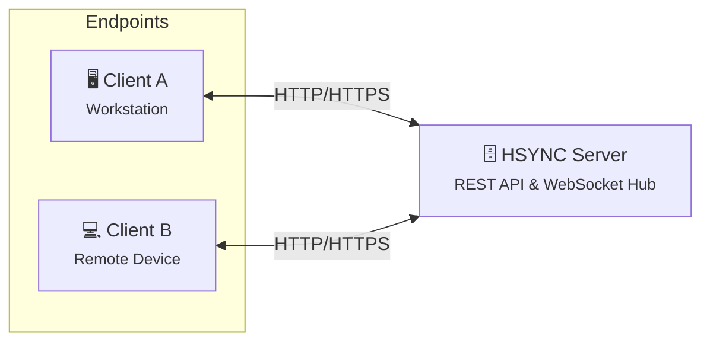
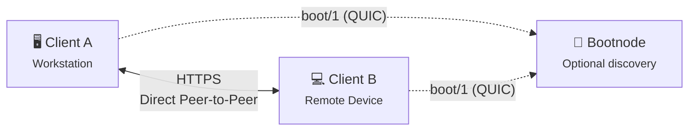
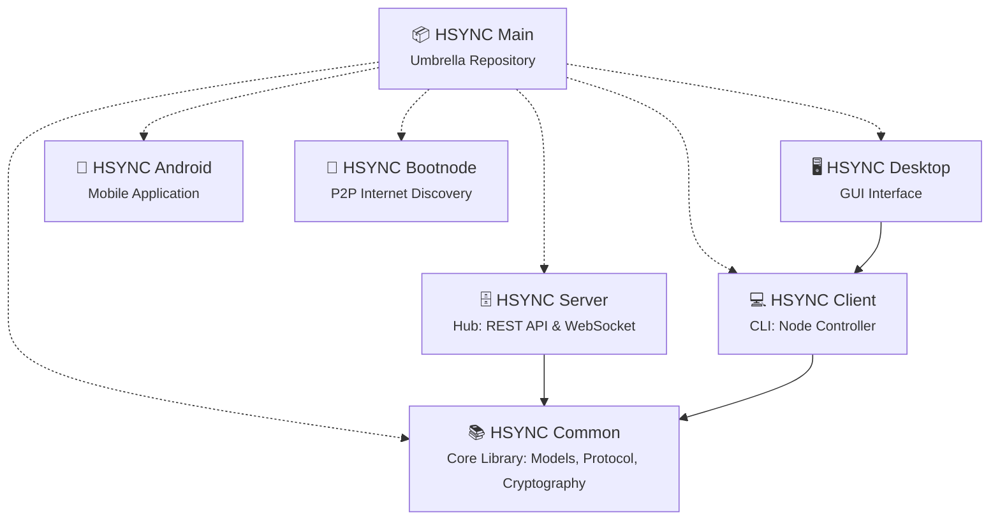

  

# HSYNC

**HSYNC** (HTTP Synchronization) provides **real-time**, **enterprise-grade** file synchronization across distributed environments, built on the standard **HTTP/HTTPS protocol**: the data plane — synchronization, transfers and events — rides REST and WebSocket calls that pass through existing firewalls, proxies and deep packet inspection systems.

This architectural design makes HSYNC the optimal solution for environments subject to strict network policies, such as corporate infrastructures, cloud deployments, and zero-trust networks where custom protocols, SSH, or VPNs are restricted. Data is stored natively on the filesystem in its original format, ensuring immediate accessibility and avoiding vendor lock-in through proprietary containers or opaque block stores.

Synchronization is supported both via a centralized hub (Client-Server with [HSYNC Server](https://github.com/albertsdk/hsync-server)) and decentralized topologies (P2P — on the local network, or across networks through an optional bootstrap node ([HSYNC Bootnode](https://github.com/albertsdk/hsync-bootnode))). Both topologies keep the same HTTP-based data plane; only **peer discovery** across networks uses QUIC (`boot/1`), and only when the devices are not on the same LAN.

> 👉 **Operational Advisory:** As with any automated filesystem mutation utility, administrators are strongly advised to maintain validated, independent backups prior to initial deployment in production environments.

---

## Architectural Applicability

HSYNC is engineered to operate seamlessly within:

* **Corporate Networks:** Operates over standard HTTP ports — the server listens on **9753** by default and is exposed on 443 by a reverse proxy (or directly with `--port 443`) — so it passes through existing firewalls, proxies, and deep packet inspection systems.
* **Cloud Infrastructures:** Fully compatible with standard IT infrastructure, including load balancers, Web Application Firewalls (WAFs), and reverse proxies.
* **Restricted Environments:** Functions autonomously in secure environments where standard administrative protocols (like SSH) or VPN access are prohibited.
* **Real-Time Workflows:** Replaces legacy polling mechanisms with event-driven, WebSocket-based push notifications for immediate data consistency.

## Technical Capabilities & Core Differentiators

### ⚙️ Core Performance Differentiators

* **Zero-Delay Sync (Fast after save):** Data transfer triggers immediately upon file closure, eliminating traditional quiet-window latencies and ensuring continuous pipeline synchronization.
* **Block-Level Delta Transfer:** For large files, the system transmits exclusively the modified data blocks (rsync-style). This drastically reduces bandwidth consumption and transfer times.
* **Direct P2P Mode:** Enables direct device-to-device synchronization without centralized server dependency, minimizing infrastructure load and maximizing local network throughput.

### 🛰️ Network & Architecture

* **Universal HTTP/HTTPS Compatibility:** Operates over standard HTTP/HTTPS ports, so it traverses common enterprise network setups without custom routing or additional port forwarding.
* **Deterministic Deletion Handling (Tombstones):** Employs strict tombstone tracking to prevent the accidental resurrection of deleted files across distributed nodes.
* **Native Symlink Support:** Accurately preserves symbolic links across platforms, a critical requirement for development environments and system administration.
* **Real-Time Architecture:** Event-driven architecture powered by WebSockets, eliminating the high overhead and inefficiency of traditional HTTP polling.
* **Private P2P Networks:** P2P clusters can be isolated from one another with a group filter and authenticated with a shared group key, so independent teams can share one physical network without ever mixing data.
* **Self-Hosted, No Vendor Lock-In:** every topology runs on infrastructure you own — the hub is your own server and buckets are plain directories on your filesystem, with no third-party service in the data path.

### 🛡️ Resilience & Data Integrity

* **Fault-Tolerant Transfers (Resumable uploads):** Automatically resumes interrupted transfers from the exact point of failure, ensuring reliable delivery of massive payloads over unstable connections.
* **Zstandard (Zstd) Compression:** Utilizes modern compression algorithms to optimize throughput, particularly effective on low-bandwidth links.
* **SHA-256 Integrity Verification:** Hashes every file end-to-end, so transmission corruption is detected before a file is committed.

### 🔐 Security, Governance & Deployment

* **Isolated Data Architecture (Bucket-based):** Organizes logical groups of files into isolated sync buckets, facilitating multi-tenant architectures and strict access control.
* **Standardized Authentication:** Secures endpoints via API Key (Bearer token) authentication, easily integrable with enterprise secret management systems.
* **Built-in Observability (Prometheus):** Exposes native metrics for direct integration into corporate monitoring and alerting stacks.
* **Containerized Deployment (Docker):** Ensures rapid, reproducible deployments via single `compose.yaml` files, ideal for cloud-native and on-premise scaling.
* **Infrastructure Protection (Rate Limiting):** Incorporates defense mechanisms against traffic spikes and abuse, ensuring high availability and service uptime.

## Market Comparison

The following table benchmarks HSYNC against industry standards across critical architectural dimensions.

| Tool | Protocol | HTTP-Native | Real-Time Sync | Native Storage | Architecture |
|------|----------|:---:|:---:|:---:|------|
| **HSYNC** | HTTP / HTTPS | ✅ | ✅ | ✅ | Hub-Spoke & P2P |
| rsync | SSH / Daemon | ❌ | ❌ | ✅ | Client-Server |
| Syncthing | BEP (Custom) | ❌ | ✅ | ✅ | P2P |
| Nextcloud | WebDAV (HTTP) | ✅ | ⚠️ ¹ | ✅ | Client-Server |
| Seafile | HTTP / HTTPS | ✅ | ⚠️ ¹ | ❌ ² | Client-Server |
| scp / sftp | SSH | ❌ | ❌ | ✅ | Client-Server |
| Unison | SSH / Socket | ❌ | ❌ | ✅ | P2P |
| Rclone | S3, SFTP, etc. | ⚠️ ⁴ | ❌ | ⚠️ ³ | Client-Server |

> **¹** Relies on local filesystem monitoring via a desktop client; lacks native event-driven push notifications (WebSocket) at the protocol level. 
> **²** Utilizes a proprietary block-based internal storage format, rendering files inaccessible from the filesystem without the server software. 
> **³** When utilizing the `crypt` backend, files are stored in an opaque encrypted format. 
> **⁴** Rclone's HTTP backend is restricted to read-only operations. Core synchronization requires non-HTTP protocols.

## Architecture Overview

HSYNC operates seamlessly in two primary network topologies:

### Server Mode (Hub-and-Spoke)

A central [HSYNC Server](https://github.com/albertsdk/hsync-server) hosts shared environments (buckets). Connected endpoints push changes via standard REST API calls and maintain a persistent WebSocket connection for event listening. Modifications on any endpoint trigger sub-second broadcast notifications, prompting immediate alignment across all nodes.

### P2P Mode (Decentralized)

Designed for serverless environments. Endpoints on the same local network autonomously discover one another over mDNS and perform direct synchronization over HTTP; groups spread across networks discover each other through an optional self-hosted [HSYNC Bootnode](https://github.com/albertsdk/hsync-bootnode) (`boot/1` over QUIC/UDP 443). Only discovery leaves HTTP: the synchronization data plane stays direct peer-to-peer over HTTPS/WSS. Ideal for high-speed, localized data transfer without central infrastructure dependencies.

## Project Ecosystem

HSYNC is developed as a modular ecosystem of specialized repositories:

| Component | Function | Lifecycle Status |
| --- | --- | --- |
| **[HSYNC Client](https://github.com/albertsdk/hsync-client)** | CLI client: Server Mode and P2P Mode | ✅ Stable |
| **[HSYNC Server](https://github.com/albertsdk/hsync-server)** | Central sync hub: REST API, WebSocket relay, file storage | ✅ Stable |
| **[HSYNC Common](https://github.com/albertsdk/hsync-common)** | Shared library: data models, protocol, delta transfer, hashing | ✅ Stable |
| **[HSYNC Bootnode](https://github.com/albertsdk/hsync-bootnode)** | Optional Internet discovery node for P2P topologies: `boot/1` over QUIC, no-log, RAM-only | ✅ Stable |
| HSYNC Desktop | Desktop GUI front-end | 🚧 In development |
| HSYNC Android | Android client app | 🚧 In development |

*Note: All Stable components ship a full test suite and documentation, and are suitable for enterprise deployment.*

## Security & Vulnerability Management

Report vulnerabilities through GitHub's private channel, never in a public issue:
**[Report a vulnerability](https://github.com/albertsdk/hsync/security/advisories/new)** — supported versions, patch management and hardening guidance are in the [Security Policy](SECURITY.md).

## Licensing

The HSYNC ecosystem is released under the **[Mozilla Public License 2.0 (MPL 2.0)](LICENSE)**.

## Disclaimer

> [!WARNING]
> **HSYNC manipulates files and directories** — it creates, overwrites, moves, and deletes data.
> Misconfiguration, software defects, or other unforeseen conditions may lead to **data loss or
> corruption**. **Use at your own risk and always keep verified, independent backups.**

**Legal Disclaimer:** THE SOFTWARE IS PROVIDED "AS IS", WITHOUT WARRANTY OF ANY KIND, EXPRESS OR IMPLIED, INCLUDING BUT NOT LIMITED TO THE WARRANTIES OF MERCHANTABILITY, FITNESS FOR A PARTICULAR PURPOSE, AND NONINFRINGEMENT. IN NO EVENT SHALL THE AUTHORS OR COPYRIGHT HOLDERS BE LIABLE FOR ANY CLAIM, DAMAGES, OR OTHER LIABILITY, WHETHER IN AN ACTION OF CONTRACT, TORT, OR OTHERWISE, ARISING FROM, OUT OF, OR IN CONNECTION WITH THE SOFTWARE OR THE USE OR OTHER DEALINGS IN THE SOFTWARE.

This disclaimer supplements, and does not replace, Sections 6 ("Disclaimer of Warranty") and 7 ("Limitation of Liability") of the [Mozilla Public License 2.0](LICENSE), which govern this software.
