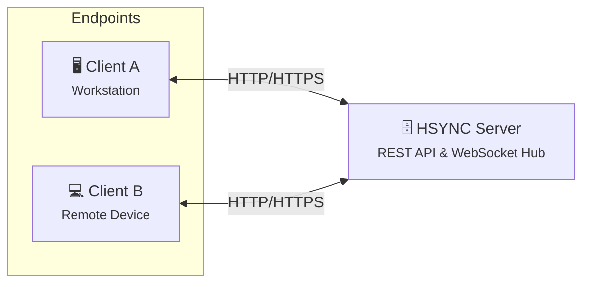
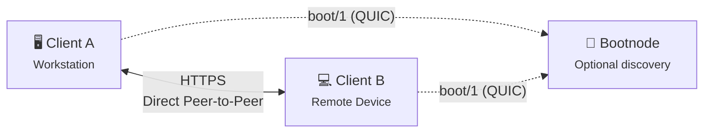
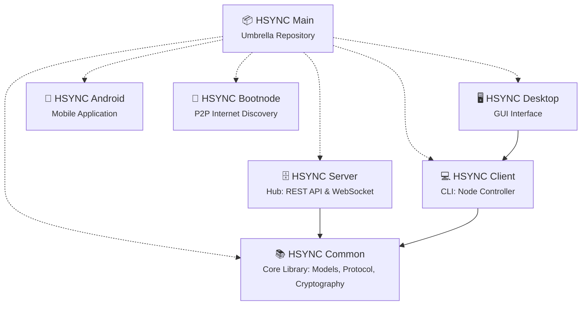

  

# HSYNC

**HSYNC** (HTTP Synchronization) is a secure, fast, **self-hosted real-time file synchronization platform** that keeps a folder identical on two or more computers using ordinary HTTPS protocol.

Install the client on the machines that matter: laptop, desktop, home server, NAS, cloud VM; point them to a folder, and every change on it (a new document, an edited photo, a renamed directory, a deletion) appears on the other machines within seconds. There is no account to create with a third-party provider and no external service in the data path: HSYNC runs on hardware you own, and your files stay in their original format, directly browsable on disk.

It works for simple setups (two laptops sharing one folder at home) and for demanding ones: with or without a central server, connecting several offices, isolated groups on the same network via direct device-to-device sync, or unattended syncs driven by scripts and schedulers. Same software, same protocol — from a single command to a fleet.

Everything HSYNC does (synchronization, transfers, and events) travels over standard HTTPS/WSS (REST and WebSocket), so it passes through the firewalls, proxies, and deep-packet-inspection systems of networks where custom protocols, SSH, or VPNs are not an option. The only exception is peer discovery between devices on different networks: it uses a different transport (QUIC over UDP 443), and only when the devices are not on the same local network.

> 👉 **Operational Advisory:** As with any automated filesystem mutation utility, administrators are strongly advised to maintain validated, independent backups prior to initial deployment in production environments.

[-A8B9CC.svg)](https://github.com/albertsdk/hsync-bootnode/tree/main/c)

---

## What you can do with HSYNC

* **Keep folders in sync** — hold the same folder on your laptop, desktop, and server; edit on any device and the others converge in seconds.
* **Back up a folder** — push it one-way to your own server or NAS, optionally without propagating deletions, so the destination never loses data just because a source file was removed.
* **Share and exchange files** — a synced folder works as a shared drop box: drop a file in on one machine (or let a colleague do it) and it lands on the others.
* **Publish a read-only copy** — distribute a mirror that other devices only download from and never write back to.
* **Sync without a server** — a few devices on the same network discover each other automatically and transfer directly, peer-to-peer, with no infrastructure to run.
* **Connect devices on different networks** — if a group is spread across networks and you do not want a central server, an optional self-hosted discovery node ([HSYNC Bootnode](https://github.com/albertsdk/hsync-bootnode)) lets the devices find each other; the file data keeps flowing directly between them.
* **Automate** — run one-shot syncs from cron, systemd timers, or CI pipelines with a documented exit code for scripting, or keep a long-running daemon that reacts to changes in real time.
* **Scale it up** — start with one folder, then add buckets, isolated groups with shared keys, ignore patterns, bandwidth limits, and per-device sync directions as your setup grows.

## Two ways to sync

HSYNC runs in one of two modes. Pick the one that fits each sync group.

### Server Mode — with a central server

A central [HSYNC Server](https://github.com/albertsdk/hsync-server) stores the shared folders (called **buckets**) and coordinates every device: changes travel to the server as standard REST API calls, and a persistent WebSocket connection announces them to the other devices, which then pull them immediately. Devices do not need to be online at the same time, they can live on different networks, and the server always holds a complete copy of the synchronized data.

**Choose it when:** you sync across networks or over the Internet, you want a central copy on hardware you own, you manage many devices or users, or you need a hub that is always reachable.

### p2p Mode — no server

Designed for serverless environments. Devices on the same local network autonomously discover one another over mDNS and perform direct synchronization over HTTP, peer-to-peer: the file data never passes through another machine, and there is nothing to install or administer beyond the devices themselves. If the group is spread across networks, the devices can use an optional self-hosted [HSYNC Bootnode](https://github.com/albertsdk/hsync-bootnode) (`boot/1` over QUIC/UDP 443) to discover each other — a stateless, no-log service that never sees your files. Only discovery leaves the local network: the synchronization data plane stays direct peer-to-peer over HTTPS/WSS.

**Choose it when:** a handful of devices share one network, you want the highest local throughput, or you prefer to run no server at all.

| Situation | Mode |
| --- | --- |
| Devices on different networks, or over the Internet | Server Mode |
| A central copy on hardware you own | Server Mode |
| Many devices, accounts, and access control | Server Mode |
| A few devices on the same network | p2p Mode |
| Direct transfers with no central copy | p2p Mode |
| No infrastructure at all — or a small self-hosted discovery node | p2p Mode (+ Bootnode across networks) |

## Choose your interface

[HSYNC Client](https://github.com/albertsdk/hsync-client) is the **reference client agent**: the `hsync` command plus the sync engine behind it. Several interfaces build on it — HSYNC Desktop and HSYNC Android are front-ends of the same role — and they all speak the same protocols and share the same data model, so different clients can take part in the same sync group. (It acts as the engine when the desktop GUI drives it as a subprocess.)

| Interface | What it gives you | Runs on | Status |
| --- | --- | --- | --- |
| **HSYNC Client** | The synchronization agent from the command line: every option, fully scriptable, headless. | Linux, macOS, Windows; `.deb`  `.rpm` packages; WD My Cloud OS5 | ✅ Stable |
| **HSYNC Desktop** | A graphical app: start and stop sync, watch transfers, adjust settings, desktop notifications. | Windows, macOS, Linux | ✅ Stable |
| **HSYNC Android** | A phone/tablet app: pick a device folder and keep it in sync. | Android (SDK 33+) | 🚧 In development |

## Privacy, security & openness

* 🏠 **Private** — no vendor account and no third-party service in the data path: Server Mode stores your data only on the hub you run yourself, and p2p Mode transfers directly between your devices.
* 🪪 **Authenticated** — every installation has a stable **device ID** with its own ECDSA P-256 keypair; peers are trusted on first use and pinned by certificate fingerprint, so a changed identity is refused and only trusted devices are accepted.
* 🧾 **Encrypted** — TLS on every transport (REST/WebSocket in Server Mode, HTTPS/WSS in p2p Mode), with no plaintext payload path.
* 📖 **Open** — the wire protocol and file model are an open, versioned specification with shared schemas and fixtures (see the [protocol](https://github.com/albertsdk/hsync-common/blob/main/docs/protocol.md) and [p2p protocol](https://github.com/albertsdk/hsync-common/blob/main/docs/p2p-protocol.md) references), and development happens in the open.
* 📡 **No telemetry** — HSYNC sends no usage data or analytics anywhere.

## Getting started

1. **Install the client** — prebuilt binaries, `.deb` packages, the WD My Cloud OS5 installer, or source: [HSYNC Client → Installation](https://github.com/albertsdk/hsync-client/blob/main/docs/installation.md).
2. **Run your first sync** — follow the walkthrough for your mode: [Server Mode](https://github.com/albertsdk/hsync-client/blob/main/docs/getting-started-server.md) or [p2p Mode](https://github.com/albertsdk/hsync-client/blob/main/docs/getting-started-p2p.md).
3. **Running your own hub?** — install the server with Docker or natively: [HSYNC Server → Getting Started](https://github.com/albertsdk/hsync-server/blob/main/docs/getting-started.md).
4. **Looking for a concrete scenario?** — backup, mirror, multi-device, NAS, photos, scheduling: [HSYNC Client → Examples](https://github.com/albertsdk/hsync-client/blob/main/docs/examples.md).

## Where HSYNC fits

HSYNC works well in these environments:

* **Corporate networks:** it speaks standard HTTP — the server listens on **9753** by default and is exposed on 443 by a reverse proxy (or directly with `--port 443`) — so it passes through existing firewalls, proxies, and deep packet inspection.
* **Cloud infrastructure:** compatible with the usual building blocks — load balancers, web application firewalls (WAFs), and reverse proxies.
* **Restricted environments:** runs where SSH or VPN access is not allowed.
* **Real-time workflows:** pushes changes as they happen over WebSockets, instead of polling for them.

## What HSYNC does well

### ⚙️ Speed

* **Sync when you save:** a transfer starts as soon as a file is closed — no quiet-window delay.
* **Block-level delta transfer:** for large files, only the changed blocks are sent (rsync-style), which cuts bandwidth and time.
* **Direct P2P mode:** devices sync straight to each other, with no server in between.

### 🛰️ Networking

* **Standard HTTP/HTTPS:** no custom ports or protocols, so it fits common network setups without extra routing.
* **Deletions stay deleted (tombstones):** a file deleted on one device is not silently brought back by another.
* **Symlinks preserved:** symbolic links are kept as-is across platforms.
* **Event-driven (WebSocket):** updates are pushed instantly instead of polled.
* **Private P2P groups:** a shared group key and a group filter keep independent clusters from mixing data on one network.
* **Self-hosted, no lock-in:** it runs on your infrastructure — the hub is your own server and buckets are plain directories on your filesystem, with no third party in the data path.

### 🛡️ Reliability & data integrity

* **Uploads resume after a drop:** an interrupted transfer continues from where it stopped.
* **Zstandard (Zstd) compression:** modern compression that helps most on slow links.
* **SHA-256 integrity checks:** every file is hashed end-to-end, so corruption is caught before a file is committed.

### 🔐 Security & operations

* **Isolated buckets:** files are grouped into separate buckets with their own access control (multi-tenant friendly).
* **Standardized API-key (Bearer) authentication:** simple tokens that plug into your secret management.
* **Prometheus metrics:** built-in metrics for your monitoring and alerting.
* **Docker-ready:** bring it up with a single `compose.yaml`.
* **Rate limiting:** protects against traffic spikes and abuse.

## Market Comparison

The following table benchmarks HSYNC against industry standards across critical architectural dimensions.

| Tool | Protocol | HTTP-Native | Real-Time Sync | Native Storage | Architecture |
|------|----------|:---:|:---:|:---:|------|
| **HSYNC** | HTTP / HTTPS | ✅ | ✅ | ✅ | Hub-Spoke & P2P |
| rsync | SSH / Daemon | ❌ | ❌ | ✅ | Client-Server |
| Syncthing | BEP (Custom) | ❌ | ✅ | ✅ | P2P |
| Nextcloud | WebDAV (HTTP) | ✅ | ⚠️ ¹ | ✅ | Client-Server |
| Seafile | HTTP / HTTPS | ✅ | ⚠️ ¹ | ❌ ² | Client-Server |
| scp / sftp | SSH | ❌ | ❌ | ✅ | Client-Server |
| Unison | SSH / Socket | ❌ | ❌ | ✅ | P2P |
| Rclone | S3, SFTP, etc. | ⚠️ ⁴ | ❌ | ⚠️ ³ | Client-Server |

> **¹** Relies on local filesystem monitoring via a desktop client; lacks native event-driven push notifications (WebSocket) at the protocol level. 
> **²** Utilizes a proprietary block-based internal storage format, rendering files inaccessible from the filesystem without the server software. 
> **³** When utilizing the `crypt` backend, files are stored in an opaque encrypted format. 
> **⁴** Rclone's HTTP backend is restricted to read-only operations. Core synchronization requires non-HTTP protocols.

## Project Ecosystem

HSYNC is developed as a modular ecosystem of specialized repositories:

| Component | Function | Lifecycle Status |
| --- | --- | --- |
| **[HSYNC Desktop](https://github.com/albertsdk/hsync-desktop)** | Desktop GUI front-end | ✅ Stable |
| **[HSYNC Client](https://github.com/albertsdk/hsync-client)** | Reference client agent: the `hsync` CLI and its sync engine | ✅ Stable |
| **[HSYNC Server](https://github.com/albertsdk/hsync-server)** | Optional central sync hub: REST API, WebSocket relay, file storage | ✅ Stable |
| **[HSYNC Bootnode](https://github.com/albertsdk/hsync-bootnode)** | Optional Internet discovery node for P2P topologies: `boot/1` over QUIC, no-log, RAM-only | ✅ Stable |
| **[HSYNC Common](https://github.com/albertsdk/hsync-common)** | Shared library: data models, protocol, delta transfer, hashing | ✅ Stable |
| HSYNC Android | Android client app | 🚧 In development |

*Note: All Stable components ship a full test suite and documentation, and are suitable for enterprise deployment.*

*Distribution packages built from these components live in their own repositories — e.g. [hsync-wd-os5](https://github.com/albertsdk/hsync-wd-os5) for WD My Cloud OS5 (`.bin` installer plus the NAS web UI, versioned with HSYNC Client).*

## Contributing

HSYNC is developed in the open. Bug reports, feature requests and pull requests are welcome — start with [CONTRIBUTING.md](CONTRIBUTING.md) and the [Code of Conduct](CODE_OF_CONDUCT.md).

## Security & Vulnerability Management

Report vulnerabilities through GitHub's private channel, never in a public issue:
**[Report a vulnerability](https://github.com/albertsdk/hsync/security/advisories/new)** — supported versions, patch management and hardening guidance are in the [Security Policy](SECURITY.md).

## 🙋‍♂️ A note from the maintainer

This project was born out of the need for a system capable of replicating the contents of a folder from a PC or Android device to a NAS, primarily for backup purposes. Several solutions were already available, but I couldn't find one that met all my requirements. This led to the somewhat questionable decision to develop one from scratch, while also providing an opportunity to gain a deeper understanding of programming languages, algorithms, frameworks, and related technologies.

Originally conceived as a hobby project, HSYNC has been under continuous development ever since. I believe it has now evolved to the point where its capabilities are comparable to those of commercial solutions, while also offering some distinctive features. As a result, it may also be suitable for deployment in certain production environments.

HSYNC is a passion project that I primarily develop and maintain in my spare time. Please keep this in mind when interacting with the project: we're all doing our best to build something great together, but this is not a paid, full-time job for any of us.

## Licensing

The HSYNC ecosystem is released under the **[BSD 3-Clause License](LICENSE)**.

## Disclaimer

> [!WARNING]
> **HSYNC manipulates files and directories** — it creates, overwrites, moves, and deletes data.
> Misconfiguration, software defects, or other unforeseen conditions may lead to **data loss or
> corruption**. **Use at your own risk and always keep verified, independent backups.**

**Legal Disclaimer:** THE SOFTWARE IS PROVIDED "AS IS", WITHOUT WARRANTY OF ANY KIND, EXPRESS OR IMPLIED, INCLUDING BUT NOT LIMITED TO THE WARRANTIES OF MERCHANTABILITY, FITNESS FOR A PARTICULAR PURPOSE, AND NONINFRINGEMENT. IN NO EVENT SHALL THE AUTHORS OR COPYRIGHT HOLDERS BE LIABLE FOR ANY CLAIM, DAMAGES, OR OTHER LIABILITY, WHETHER IN AN ACTION OF CONTRACT, TORT, OR OTHERWISE, ARISING FROM, OUT OF, OR IN CONNECTION WITH THE SOFTWARE OR THE USE OR OTHER DEALINGS IN THE SOFTWARE.

This disclaimer supplements, and does not replace, the warranty disclaimer and limitation of liability provisions of the [BSD 3-Clause License](LICENSE), which govern this software.
