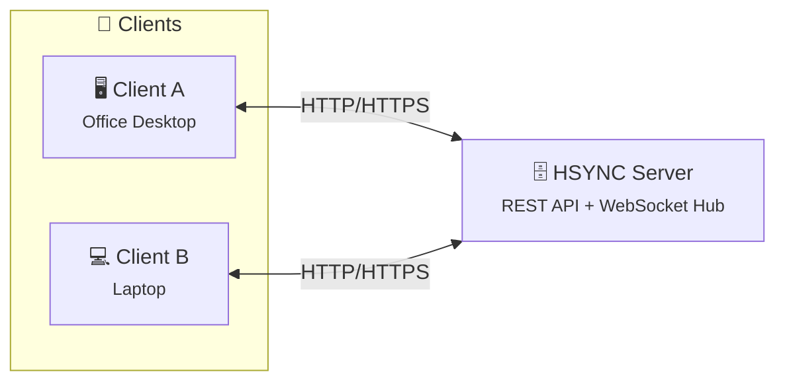

<p align="center">
  
</p>

# HSYNC

**HSYNC** is an open-source file synchronization system that works over standard
HTTP/HTTPS — no custom protocols, no SSH, no VPN required. Keep your files in
sync across all your devices, even in the most restricted network environments.

> [!NOTE]
> 👉 **Remember:** keep verified backups of your data when trying new
> synchronization tools. 😉

---

[](LICENSE)
[](https://www.python.org/)
[](https://www.docker.com/)

---

## Why HSYNC?

Most file sync tools rely on SSH, custom protocols, or peer-to-peer
connections that are often blocked by corporate firewalls, cloud load
balancers, or restrictive network policies. HSYNC was designed from the
ground up to work everywhere HTTP works — which is everywhere.

| Tool | Required Protocol | Works over HTTP only? |
|------|-------------------|-----------------------|
| **HSYNC** | HTTP / HTTPS | ✅ **Yes** |
| rsync | SSH or rsync daemon | ❌ No |
| Syncthing | BEP (custom protocol) | ❌ No |
| FTP / FTPS | FTP | ❌ No |

**HSYNC fits naturally into:**
- 🏢 **Corporate networks** — only ports 80/443 are open through the firewall
- ☁️ **Cloud environments** — services behind load balancers or reverse proxies
- 🔒 **Restricted infrastructures** — SSH is disabled, VPNs unavailable
- 🌐 **Web-friendly setups** — route traffic through CDNs, WAFs, or API gateways
- ⚡ **Real-time reactivity** — WebSocket-powered instant notifications, no polling

## How It Works

HSYNC operates in two modes, both using only HTTP/HTTPS:

### Server Mode



A central **HSYNC Server** stores shared folders (called *buckets*). Each
client uploads changes via REST API and receives real-time notifications
through a WebSocket connection. When a file changes on one device, all
other connected devices are instantly notified and can pull the update.

### LAN / P2P Mode


No server required — two clients on the same local network discover each
other automatically and sync files directly over HTTP. Perfect for
quick ad-hoc sync between two machines without infrastructure.

## Project Structure

HSYNC is a family of projects, each with a specific role:

| Repository | Role | Status |
|------------|------|--------|
| **[HSYNC Server](https://github.com/albertobasso/hsync-server)** | Central sync hub: REST API, WebSocket relay, file storage | ✅ Stable |
| **[HSYNC Client](https://github.com/albertobasso/hsync-client)** | CLI client: Server Mode and LAN/P2P Mode | ✅ Stable |
| **[HSYNC Common](https://github.com/albertobasso/hsync-common)** | Shared library: data models, protocol, delta transfer, hashing | ✅ Stable |
| HSYNC Desktop | Desktop GUI front-end | 🚧 In development |
| HSYNC Android | Android client app | 🚧 In development |

All three stable projects are production-grade, tested, and documented.

## Key Features

- 🚀 **HTTP/HTTPS only** — works through any proxy, firewall, or load balancer
- 📁 **Bucket-based organization** — group files into isolated sync folders
- 🔄 **Real-time sync** — WebSocket push notifications, no polling
- ⚡ **LAN/P2P Mode** — direct device-to-device sync without a server
- 🧩 **Delta transfer** — rsync-style block-level sync for large files
- ⏩ **Resumable uploads** — pick up interrupted transfers where they left off
- 🗜️ **Zstandard compression** — faster transfers over slow links
- 🔐 **API Key authentication** — simple, secure Bearer token auth
- ✅ **SHA-256 integrity** — every file is verified end-to-end
- 🪦 **Deletion tombstones** — prevent deleted files from being resurrected
- 🔗 **Symlink support** — preserve symbolic links across devices
- 🛡️ **Rate limiting** — protect the server from abuse
- 📊 **Prometheus metrics** — built-in observability
- 🐳 **Docker-ready** — deploy with a single `compose.yaml`

## Quick Start

Get a full HSYNC system running in under 5 minutes:

### 1. Start the Server

```bash
git clone https://github.com/albertobasso/hsync-server.git
cd hsync-server
./install.sh
```

The install script downloads a pinned release, generates secrets, and starts
the server with Docker Compose.

### 2. Connect a Client

```bash
git clone https://github.com/albertobasso/hsync-client.git
cd hsync-client
pip install hsync-client

# Server Mode — sync with the central server
hsync sync --server https://your-server:9753 --api-key YOUR_API_KEY --bucket my-bucket

# LAN Mode — direct peer-to-peer sync on the local network
hsync sync --lan --bucket my-bucket
```

### 3. Add More Devices

Repeat step 2 on any other machine. All devices connected to the same bucket
will stay in sync automatically.

For detailed instructions, see:
- [HSYNC Server — Getting Started](https://github.com/albertobasso/hsync-server/blob/main/docs/getting-started.md)
- [HSYNC Client — README](https://github.com/albertobasso/hsync-client/blob/main/README.md)
- [HSYNC Server — Deployment Guide](https://github.com/albertobasso/hsync-server/blob/main/docs/deployment.md) (for production setups)

## Documentation

Each project has its own comprehensive documentation:

| Project | Documentation |
|---------|---------------|
| HSYNC Server | [docs/README.md](https://github.com/albertobasso/hsync-server/blob/main/docs/README.md) — API reference, deployment, operations, security |
| HSYNC Client | [docs/README.md](https://github.com/albertobasso/hsync-client/blob/main/docs/README.md) — CLI reference, configuration, LAN/P2P guide |
| HSYNC Common | [docs/README.md](https://github.com/albertobasso/hsync-common/blob/main/docs/README.md) — Models, protocol, utilities |

## Contributing

HSYNC welcomes contributions! Each project has its own `CONTRIBUTING.md` with
setup instructions, coding standards, and the contribution workflow:

- [HSYNC Server — Contributing](https://github.com/albertobasso/hsync-server/blob/main/CONTRIBUTING.md)
- [HSYNC Client — Contributing](https://github.com/albertobasso/hsync-client/blob/main/CONTRIBUTING.md)
- [HSYNC Common — Contributing](https://github.com/albertobasso/hsync-common/blob/main/CONTRIBUTING.md)

## License

All HSYNC projects are licensed under the [Mozilla Public License 2.0](LICENSE).

## Disclaimer

> [!WARNING]
> **HSYNC manipulates files and directories** — it creates, overwrites, moves,
> and deletes data. Misconfiguration, software defects, or other unforeseen
> conditions may lead to **data loss or corruption**. **Use at your own risk
> and always keep verified, independent backups.**

THE SOFTWARE IS PROVIDED "AS IS", WITHOUT WARRANTY OF ANY KIND, EXPRESS OR
IMPLIED, INCLUDING BUT NOT LIMITED TO THE WARRANTIES OF MERCHANTABILITY,
FITNESS FOR A PARTICULAR PURPOSE, AND NONINFRINGEMENT. Although the author
has implemented reasonable safety measures, IN NO EVENT SHALL THE AUTHOR OR
COPYRIGHT HOLDERS BE LIABLE FOR ANY CLAIM, DAMAGES, OR OTHER LIABILITY —
including, without limitation, any direct, indirect, incidental, special,
exemplary, or consequential damages, loss of data, or business interruption —
WHETHER IN AN ACTION OF CONTRACT, TORT, OR OTHERWISE, ARISING FROM, OUT OF,
OR IN CONNECTION WITH THE SOFTWARE OR THE USE OR OTHER DEALINGS IN THE
SOFTWARE.

This disclaimer supplements, and does not replace, Sections 6 ("Disclaimer
of Warranty") and 7 ("Limitation of Liability") of the
[Mozilla Public License 2.0](LICENSE), which govern this software.